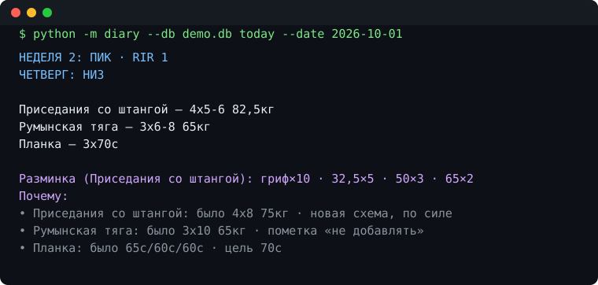
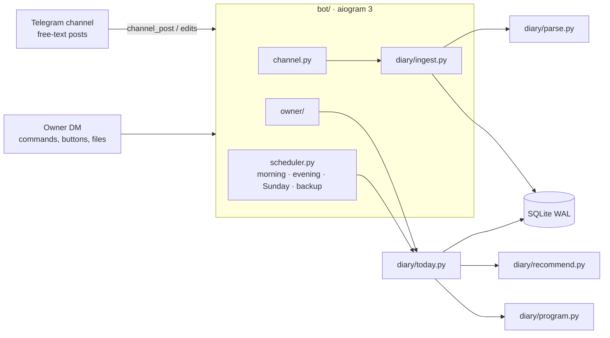

# training-diary-bot

English | [Русский](README.ru.md)

[](https://github.com/ChillArtisan/training-diary-bot/actions/workflows/ci.yml)


[](LICENSE)

A Telegram bot that turns a private gym-diary channel into a training coach.

You keep writing workouts the way you always did — free text, typos, notes and all.
The bot reads the channel, builds a database out of it, knows where you are in your
program, and every training morning posts the day's plan **with recommended weights**
and a one-line reason for each.

<p align="center">
  
</p>
<p align="center"><em>CLI output on the bundled synthetic demo export (<code>python -m diary today --date 2026-10-01</code>). The bot posts the same text to the channel.</em></p>

The bot speaks Russian (it was built for a real Russian-speaking diary); the code, docs and tests are in English.

## Contents

- [What it does](#what-it-does)
- [How the weights are chosen](#how-the-weights-are-chosen)
- [Commands](#commands)
- [Architecture](#architecture)
- [Project structure](#project-structure)
- [Quick start](#quick-start)
- [Try it without Telegram](#try-it-without-telegram)
- [Development](#development)

## What it does

**Reads messy human logs.** A tolerant line grammar understands what people actually type:

| Written in the channel | Understood as |
| :--- | :--- |
| `Жим лёжа 5 x 6-8 70кг (1-8; 2-8; 3-7)` | 5 sets of 70 kg: 8, 8, 7, then 6, 6 |
| `Армейский жим 4x6 35кг(первый) 32,5кг(остальные три)` | per-set weights 35 / 32.5 / 32.5 / 32.5 |
| `Подтягивания 5 x 6-8 +5кг` | weighted pull-ups, bodyweight + 5 kg |
| `Планка 3хмакс(71с; 70с; 70с)` | timed sets |
| `Тяга в наклоне 3x12 62,5кг - потом делай 65кг` | a note to self, used next time |
| `Суперсет: бицепс 19кг + французский жим 3х12 24кг` | two exercises sharing a scheme |
| `вчера` / `ВТОРНИК 27.10: НИЗ А` | the workout happened earlier |
| `70,2кг` / `Обхват груди: 95` | body weight and measurements |

Exercise names are matched through aliases, light lemmatization and fuzzy matching;
when two names are only *probably* the same, the bot asks with two buttons instead of guessing.
On the author's private diary export (174 posts over 13 months, several different programs) about 99% of exercise lines parsed when last measured by hand; that data is not published. CI checks the synthetic demo export in `examples/`.

**Recommends weights.** `diary/recommend.py` is a set of pure functions:

- *double progression* against the program's rep range: all sets at the top → add the smallest step; a miss → hold; two misses → −5%;
- *estimated 1RM with reps in reserve* when the rep scheme or RIR target changes between weeks (Epley + RIR);
- deload weeks don't inflate the strength estimate;
- a *break penalty* (14 / 30 / 60 days → ×0.9 / 0.8 / 0.7), calibrated on the author's own comeback after three months off;
- your own notes win: «не добавлять», «можно добавить», «потом делай 65»;
- rounding to what exists in the gym: barbell plates, the dumbbell rack, odd machine stacks you have used before.

**Tracks the program.** A program is just another post. Position in the cycle is *sequence-based*:
the next day is the one after the last logged workout, so a missed gym day never silently shifts the cycle.
Workouts split over two posts, posted a day late, or written without headers are still matched.

**Handles bad days.**

| Situation | Command |
| :--- | :--- |
| Feeling rough | `/light` — −15% and one set less |
| Short on time | `/short` — only the main lifts |
| Machine taken | `/swap` — alternatives you have actually done, with weights |
| Something hurts | `/avoid жим лёжа` — replaced in every plan until `/allow` |
| Sick or travelling | `/pause 7` — reminders stop; logging a workout ends the pause |
| Long break | `/restart` — start the cycle over; weights already account for the gap |

**Keeps you going.** Morning plan in the channel on training days, an evening check-in if nothing was logged,
a Sunday summary (sessions, tonnage, records, streak, body weight), a gentle note after a week of silence,
🔥 reactions on personal records.

**Shows progress.** A persistent keyboard in the private chat (📋 План · 😵 Лёгкий · ⏱ Коротко · 🔁 Замена ·
📈 Прогресс · 📊 Аналитика · ⏸ Пауза) and charts rendered with matplotlib:

- *strength* per exercise: estimated 1RM per session, working weight, record markers;
- *consistency*: a GitHub-style calendar, adherence to the planned days per week, current and best streak,
  the weekday you skip most, and consistency since the last comeback after a break;
- *session efficiency (KPD)*: plan completion (40%) + sets that reached the bottom of the rep range (40%) +
  progress against the same program day of the previous cycle (20%); deload weeks are not penalized for no progress.
  Sent after every logged workout;
- *weekly volume per muscle group* against the common 10–20 sets guideline, push/pull balance;
- body weight with a 7-day average and measurement changes;
- *goals with a forecast*: `/goal жим лёжа 100 к лету` measures your pace with a robust trend (the median of pairwise
  slopes since the last break, so one great or awful day barely moves it), says roughly when the goal comes, with a range,
  and whether the deadline holds or what weekly gain it needs. The strength chart shows the goal line and the projection;
  reached goals are congratulated once;
- a monthly report on the 1st and a chart with the Sunday summary.

**Runs without a maintainer.**

- pairing without config: only `BOT_TOKEN` is required. The first start logs a one-time pair code; send `/start <code>` to the bot, then forward it a channel post (Telegram confirms you are an admin there). `OWNER_ID` / `CHANNEL_ID` pin both and win over the database. `/rebind` moves the bot to another channel;
- parser upgrades re-read every stored post automatically (`PARSER_VERSION`), schema changes go through `PRAGMA user_version` migrations;
- daily SQLite backups (14 kept), a weekly copy sent to the owner, `/export` to CSV. To restore, send the backup `.db` file to the bot: it is validated, the current database is backed up first, then you confirm;
- Docker healthcheck on a heartbeat file, errors reported to the owner at most once per 30 minutes, a "was down for N minutes" note after outages. The healthcheck also goes red when polling stops working (revoked token, 409 conflict, dead proxy), and after 15 minutes without a successful poll the bot exits so Docker restarts it. Telegram keeps unprocessed updates for about 24 hours: posts written during a shorter downtime are processed on return; after a longer one, forward the missing posts to the bot or send a channel export.

## How the weights are chosen

All of it lives in `diary/recommend.py` as pure functions; the tunable numbers sit at the top of the file.
Every recommendation carries a one-line reason, so you can see why a number was picked.

1. **Same scheme as last time** (same rep range, RIR within 0.6) means *double progression* on the last top weight:
   - every set reached the top of the range: add the smallest step (2.5 kg for barbell, machine and cable; the next dumbbell in the rack; +1 on plate-count machines);
   - a set below the bottom of the range: hold the weight;
   - below the bottom twice in a row at the same weight: **−5%**;
   - anywhere in between: same weight, add reps.
2. **The scheme or the RIR target changed** (new week, new phase) means an *estimated 1RM with reps in reserve*:
   `e1RM = w · (1 + (reps + RIR) / 30)` (Epley). The best e1RM of the last 42 days is converted back to the new rep minimum and RIR,
   then clamped to ×0.90…×1.10 of the last weight.
   Deload sessions (RIR ≥ 4) are left out of the estimate when other sessions exist, because deload sets are rarely done at the logged RIR.
   On a deload week itself the lower clamp is ×0.50.
3. **Your notes win**: «не добавлять» caps the weight, «можно добавить» forces a step up, «потом делай 65кг» sets the target.
4. **Break penalty** on the final weight when the last session is more than 14 / 30 / 60 days old: ×0.9 / ×0.8 / ×0.7.
   Timed exercises (planks) get the same factor on the target; otherwise the target is +5 s over the best set.
5. **Rounding to what exists**: 2.5 kg steps by default; dumbbells go to the nearest weight in the rack
   (set yours with `/set dumbbell_steps`); machines and cables snap to a stack weight you have used before if it is within 1.5 kg.

An exercise with no history gets "new, pick a weight". `/light` takes 15% off and drops one set; `/short` keeps only the main lifts.

## Commands

All commands go to the bot in a private chat with the owner.

| Command | What it does |
| :--- | :--- |
| `/plan` | Today's plan with weights, shown only to you |
| `/today` | The same plan, posted to the channel |
| `/light` | Bad-day plan: −15% weight, one set less |
| `/short` | Short-on-time plan: main lifts only |
| `/swap` | Alternatives for a taken machine, from exercises you have actually done |
| `/cycle` | Where you are in the program; `/cycle 6` makes day 6 the next one |
| `/skip` | Skip the next program day |
| `/restart` | Start the cycle over from week 1 |
| `/program` | Switch to another program post |
| `/pause 7` | Stop reminders for 7 days (or until a date, `/pause 15.11`); logging a workout ends the pause |
| `/resume` | End the pause |
| `/avoid жим лёжа` | Replace an exercise in every plan until `/allow` |
| `/allow` | Bring an avoided exercise back |
| `/ex жим лёжа` | Last sets of an exercise |
| `/analytics` | Consistency calendar, weekly chart, volume per muscle group and written insights |
| `/progress` | Strength chart: pick an exercise with buttons or `/progress жим лёжа` |
| `/kpd` | Efficiency of recent sessions with a chart |
| `/goal жим лёжа 100 к 01.06` | Set a goal (`100x5`, `вес 75`, `к лету`, `через 3 месяца` work too); `/goal` lists goals with forecasts |
| `/stats` | Overall picture |
| `/week` | Weekly summary |
| `/body` | Body weight chart and measurements |
| `/plates 82.5` | Plates per side for a target weight |
| `/warmup 100` | Warm-up ramp to a working weight |
| `/merge` | Review exercise names the bot thinks are the same |
| `/alias икры стоя = Подъём на носки стоя` | Teach the bot a name |
| `/equip жим ногами = тренажёр` | Set an exercise's equipment type |
| `/forget <link>` | Forget a channel post |
| `/import` | Import a channel export (`result.json`, `messages.html` or a zip); export without media, bots can download files up to 20 MB |
| `/rebind` | Switch to another channel (forward a post from it) |
| `/export` | All sets as CSV |
| `/backup` | Send a copy of the database; send a `.db` file back to restore |
| `/settings`, `/set key value` | Reminder times, toggles, bar weight, dumbbell rack |
| `/status` | Bot state and version |
| `/start <code>`, `/help` | Claim the bot with the pair code, command list |

You can also send a workout to the bot directly; it posts it to the channel. A channel post forwarded to the bot is read as that post (useful after a long downtime).

## Architecture



`diary/` has no Telegram dependency: everything is testable and usable from the CLI.
More detail, the data model and the self-healing mechanisms: [docs/architecture.md](docs/architecture.md).

## Project structure

```
diary/                  pure logic, no Telegram
  parse.py              free-text line grammar, PARSER_VERSION
  aliases.py            exercise names: normalization, synonyms, equipment guess, fuzzy match
  ingest.py             posts -> database; imports; re-parse after parser updates
  program.py            position in the program cycle: next day, skip, restart
  recommend.py          weight recommendation (pure functions, all constants)
  today.py              builds and renders the day's plan
  stats.py              records, progress, weekly summary
  analytics.py          session KPD, consistency, volume per muscle group, insights
  goals.py              goals: robust trend, forecast, deadlines
  charts.py             PNG charts (matplotlib object API, safe in a worker thread)
  movement.py           exercise alternatives for /swap and /avoid
  plates.py             plates per side, warm-up ramp
  backup.py             SQLite backups, CSV export
  state.py              pause and avoid-list state
  db.py, schema.sql     SQLite access, schema, MIGRATIONS
  __main__.py           CLI: import | today | cycle | suggestions
bot/                    aiogram 3 layer
  __main__.py           startup, polling, downtime notice, command menu
  channel.py            channel posts and edits
  owner/                owner commands and buttons, one module per area (plan, progress, data, restore, settings, pairing, text)
  health.py             heartbeat, polling watchdog, writable-data check
  pending.py            short-lived owner prompts with expiry
  ui.py                 persistent keyboard, chart delivery
  scheduler.py          timed jobs, heartbeat
  common.py             identity, error alerts, helpers
  prefs.py              owner-editable settings
  config.py             environment configuration
tests/                  pytest suite
examples/               synthetic demo export and its generator
docs/                   architecture notes, demo.svg
```

## Quick start

```bash
git clone https://github.com/ChillArtisan/training-diary-bot && cd training-diary-bot
cp .env.example .env          # put BOT_TOKEN from @BotFather there
mkdir -p data import          # the container runs as uid 1000; create the folders as that user
docker compose build && docker compose up -d
docker compose logs training_diary_bot | grep "Pair code"
```

1. Add the bot to your diary channel as an admin with «Post messages».
2. Send `/start <pair code>` to the bot (the code is in the log line above), then forward it any post from the channel.
3. Optional: send the bot your channel export (`result.json`, `messages.html` or a zip, exported without media: Telegram gives bots files up to 20 MB) to import the history.

If `data/` was created by Docker as root, the bot says so and exits with code 2: `sudo chown 1000:1000 data import`.
`PROXY_URL` (http or socks5) is supported for networks where Telegram is blocked; `DIARY_TZ` sets the timezone (default `Europe/Moscow`).

## Try it without Telegram

```bash
pip install -r requirements.txt -c constraints.txt
python examples/make_demo_export.py
python -m diary --db demo.db import examples/demo_export
python -m diary --db demo.db today --date 2026-10-01
python -m diary --db demo.db cycle
```

## Development

```bash
pip install -r requirements.txt -c constraints.txt -r requirements-dev.txt
ruff check .
pytest -q
```

Tests run against the bundled synthetic export; `DIARY_EXPORT=/path/to/export pytest` adds an acceptance run on a real one.
Tunable numbers live at the top of `diary/recommend.py`; grammar changes go into `diary/parse.py` together with a `PARSER_VERSION` bump.

## License

MIT
