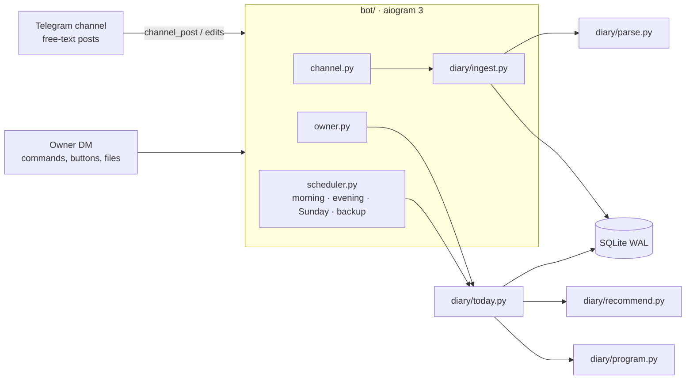

# training-diary-bot

[](https://github.com/ChillArtisan/training-diary-bot/actions/workflows/ci.yml)

A Telegram bot that turns a private gym-diary channel into a training coach.

You keep writing workouts the way you always did — free text, typos, notes and all.
The bot reads the channel, builds a database out of it, knows where you are in your
program, and every training morning posts the day's plan **with recommended weights**
and a one-line reason for each.

```
НЕДЕЛЯ 2: ПИК · RIR 1
ЧЕТВЕРГ: НИЗ

Приседания со штангой – 4x5-6 82,5кг
Румынская тяга – 3x6-8 65кг
Планка – 3x70с

Разминка (Приседания со штангой): гриф×10 · 32,5×5 · 50×3 · 65×2
• Приседания со штангой: было 4x8 75кг · новая схема, по силе
• Румынская тяга: было 3x10 65кг · пометка «не добавлять»
• Планка: было 65с/60с/60с · цель 70с
```

The bot speaks Russian (it was built for a real Russian-speaking diary); the code, docs and tests are in English.

## What it does

**Reads messy human logs.** A tolerant line grammar understands what people actually type:

| Written in the channel | Understood as |
| :--- | :--- |
| `Жим лёжа 5 x 6-8 70кг (1-8; 2-8; 3-7)` | 5 sets of 70 kg: 8, 8, 7, then 6, 6 |
| `Армейский жим 4x6 35кг(первый) 32,5кг(остальные три)` | per-set weights 35 / 32.5 / 32.5 / 32.5 |
| `Подтягивания 5 x 6-8 +5кг` | weighted pull-ups, bodyweight + 5 kg |
| `Планка 3хмакс(71с; 70с; 70с)` | timed sets |
| `Тяга в наклоне 3x12 62,5кг - потом делай 65кг` | a note to self, used next time |
| `Суперсет: бицепс 19кг + французский жим 3х12 24кг` | two exercises sharing a scheme |
| `вчера` / `ВТОРНИК 27.10: НИЗ А` | the workout happened earlier |
| `70,2кг` / `Обхват груди: 95` | body weight and measurements |

Exercise names are matched through aliases, light lemmatization and fuzzy matching;
when two names are only *probably* the same, the bot asks with two buttons instead of guessing.
On the author's real diary (174 posts over 13 months, several different programs) it parses 99% of exercise lines.

**Recommends weights.** `diary/recommend.py` is a set of pure functions:

- *double progression* against the program's rep range: all sets at the top → add the smallest step; a miss → hold; two misses → −5%;
- *estimated 1RM with reps in reserve* when the rep scheme or RIR target changes between weeks (Epley + RIR);
- deload weeks don't inflate the strength estimate;
- a *break penalty* (14 / 30 / 60 days → ×0.9 / 0.8 / 0.7), calibrated on the author's own comeback after three months off;
- your own notes win: «не добавлять», «можно добавить», «потом делай 65»;
- rounding to what exists in the gym: barbell plates, the dumbbell rack, odd machine stacks you have used before.

**Tracks the program.** A program is just another post. Position in the cycle is *sequence-based*:
the next day is the one after the last logged workout, so a missed gym day never silently shifts the cycle.
Workouts split over two posts, posted a day late, or written without headers are still matched.

**Handles bad days.**

| Situation | Command |
| :--- | :--- |
| Feeling rough | `/light` — −15% and one set less |
| Short on time | `/short` — only the main lifts |
| Machine taken | `/swap` — alternatives you have actually done, with weights |
| Something hurts | `/avoid жим лёжа` — replaced in every plan until `/allow` |
| Sick or travelling | `/pause 7` — reminders stop; logging a workout ends the pause |
| Long break | `/restart` — start the cycle over; weights already account for the gap |

**Keeps you going.** Morning plan in the channel on training days, an evening check-in if nothing was logged,
a Sunday summary (sessions, tonnage, records, streak, body weight), a gentle note after a week of silence,
🔥 reactions on personal records.

**Runs without a maintainer.**

- zero-config pairing: only `BOT_TOKEN` is required — forward any channel post to the bot and Telegram itself confirms you are an admin there;
- parser upgrades re-read every stored post automatically (`PARSER_VERSION`), schema changes go through `PRAGMA user_version` migrations;
- daily SQLite backups (14 kept), a weekly copy sent to the owner, `/export` to CSV;
- Docker healthcheck on a heartbeat file, errors reported to the owner at most once per 30 minutes, a "was down for N minutes" note after outages; posts written during downtime are still processed.

## Architecture



`diary/` has no Telegram dependency: everything is testable and usable from the CLI.

## Quick start

```bash
git clone https://github.com/ChillArtisan/training-diary-bot && cd training-diary-bot
cp .env.example .env          # put BOT_TOKEN from @BotFather there
docker compose build && docker compose up -d
```

1. Add the bot to your diary channel as an admin with «Post messages».
2. Send `/start` to the bot and forward it any post from the channel.
3. Optional: send the bot your channel export (`result.json`, `messages.html` or a zip) to import the history.

`PROXY_URL` (http or socks5) is supported for networks where Telegram is blocked.

## Try it without Telegram

```bash
pip install -r requirements.txt -c constraints.txt
python examples/make_demo_export.py
python -m diary --db demo.db import examples/demo_export
python -m diary --db demo.db today
python -m diary --db demo.db cycle
```

## Development

```bash
pip install -r requirements.txt -c constraints.txt pytest
pytest -q
```

Tests run against the bundled synthetic export; `DIARY_EXPORT=/path/to/export pytest` adds an acceptance run on a real one.
Tunable numbers live at the top of `diary/recommend.py`; grammar changes go into `diary/parse.py` together with a `PARSER_VERSION` bump.

## License

MIT
