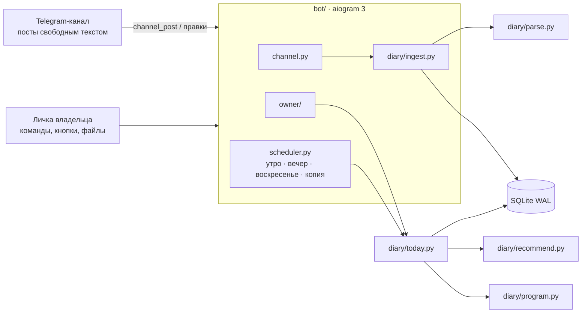

# training-diary-bot

[English](README.md) | Русский

[](https://github.com/ChillArtisan/training-diary-bot/actions/workflows/ci.yml)


[](LICENSE)

Telegram-бот, который превращает личный канал с дневником тренировок в тренера.

Вы продолжаете писать тренировки как привыкли: свободным текстом, с опечатками и пометками.
Бот читает канал, собирает из него базу, знает, на каком вы месте программы, и в каждый тренировочный день
с утра выкладывает план **с рекомендованными весами** и короткой причиной для каждого.

<p align="center">
  
</p>
<p align="center"><em>Вывод CLI на синтетическом демо-экспорте из репозитория (<code>python -m diary today --date 2026-10-01</code>). Бот публикует в канал тот же текст.</em></p>

Бот говорит по-русски (его делали для настоящего русскоязычного дневника); код, документация и тесты написаны на английском.

## Содержание

- [Что умеет](#что-умеет)
- [Как выбираются веса](#как-выбираются-веса)
- [Команды](#команды)
- [Архитектура](#архитектура)
- [Структура проекта](#структура-проекта)
- [Быстрый старт](#быстрый-старт)
- [Попробовать без Telegram](#попробовать-без-telegram)
- [Разработка](#разработка)

## Что умеет

**Читает неряшливые записи.** Терпимая грамматика строк понимает то, что люди реально пишут:

| Написано в канале | Как понимается |
| :--- | :--- |
| `Жим лёжа 5 x 6-8 70кг (1-8; 2-8; 3-7)` | 5 подходов по 70 кг: 8, 8, 7, затем 6, 6 |
| `Армейский жим 4x6 35кг(первый) 32,5кг(остальные три)` | веса по подходам 35 / 32,5 / 32,5 / 32,5 |
| `Подтягивания 5 x 6-8 +5кг` | подтягивания с отягощением: вес тела + 5 кг |
| `Планка 3хмакс(71с; 70с; 70с)` | подходы на время |
| `Тяга в наклоне 3x12 62,5кг - потом делай 65кг` | заметка себе, учитывается в следующий раз |
| `Суперсет: бицепс 19кг + французский жим 3х12 24кг` | два упражнения с общей схемой |
| `вчера` / `ВТОРНИК 27.10: НИЗ А` | тренировка была раньше |
| `70,2кг` / `Обхват груди: 95` | вес тела и замеры |

Названия упражнений сопоставляются через алиасы, лёгкую лемматизацию и нечёткий поиск;
если два названия лишь *возможно* означают одно и то же, бот спрашивает двумя кнопками, а не угадывает.
На закрытом экспорте дневника автора (174 поста за 13 месяцев, несколько разных программ) при последнем ручном замере разбиралось около 99% строк с упражнениями; эти данные не опубликованы. CI проверяет синтетический демо-экспорт из `examples/`.

**Рекомендует веса.** `diary/recommend.py` — набор чистых функций:

- *двойная прогрессия* по диапазону повторений программы: все подходы на верхней границе — прибавляем минимальный шаг; недобор — держим вес; два недобора подряд — −5%;
- *расчётный 1ПМ с запасом повторений*, когда между неделями меняется схема или целевой RIR (Эпли + RIR);
- разгрузочные недели не завышают оценку силы;
- *штраф за перерыв* (14 / 30 / 60 дней → ×0,9 / 0,8 / 0,7), подобранный по возвращению автора после трёх месяцев без зала;
- ваши пометки главнее: «не добавлять», «можно добавить», «потом делай 65»;
- округление до того, что есть в зале: блины для штанги, стойка гантелей, нестандартные плиты тренажёров, на которых вы уже работали.

**Ведёт программу.** Программа — тоже обычный пост. Позиция в цикле считается *по порядку*:
следующий день — тот, что идёт после последней записанной тренировки, поэтому пропущенный день не сдвигает цикл молча.
Тренировки, разбитые на два поста, записанные на следующий день или без заголовков, всё равно находят своё место.

**Переживает плохие дни.**

| Ситуация | Команда |
| :--- | :--- |
| Паршивое самочувствие | `/light` — −15% и на подход меньше |
| Мало времени | `/short` — только основные движения |
| Тренажёр занят | `/swap` — замены из того, что вы реально делали, с весами |
| Что-то болит | `/avoid жим лёжа` — заменяется во всех планах до `/allow` |
| Болезнь или поездка | `/pause 7` — напоминания замолкают; запись тренировки снимает паузу |
| Долгий перерыв | `/restart` — цикл с начала; веса уже учитывают паузу |

**Не даёт забросить.** Утренний план в канале в тренировочные дни, вечерний вопрос, если тренировки не было,
воскресные итоги (тренировки, тоннаж, рекорды, серия, вес тела), мягкое напоминание после недели тишины,
реакция 🔥 на личные рекорды. В канал уходит только программа — её удобно скопировать и заполнять по ходу
тренировки (почему такие веса — в `/plan`). Пост тренировки можно править по подходу: пока он меняется, на нём ✍,
а итог (КПД, рекорды, неразобранные строки) приходит, когда пост 40 минут не правили (`/set log_settle`).

**Показывает прогресс.** В личке постоянная клавиатура (📋 План · 😵 Лёгкий · ⏱ Коротко · 🔁 Замена ·
📈 Прогресс · 📊 Аналитика · ⏸ Пауза) и графики на matplotlib:

- *сила* по каждому упражнению: оценка 1ПМ по тренировкам, рабочий вес, отметки рекордов;
- *постоянство*: календарь в стиле GitHub, сколько плановых дней в неделю выполнено, текущая и лучшая серия,
  какой день недели выпадает чаще всего и постоянство с момента возвращения после перерыва;
- *КПД тренировки*: выполнение плана (40%) + подходы, где добрана нижняя граница повторов (40%) +
  прибавка к тому же дню прошлого цикла (20%); разгрузку за отсутствие прибавки не штрафует.
  Приходит после каждой записанной тренировки;
- *объём по мышцам* в подходах в неделю против привычного ориентира 10–20, баланс жимов и тяг;
- вес тела со средним за 7 дней и изменения замеров;
- *цели с прогнозом*: `/goal жим лёжа 100 к лету` — бот меряет темп устойчивым трендом (медиана наклонов между парами
  тренировок с последнего перерыва, так что один удачный или провальный день почти ничего не сдвигает), говорит, когда
  примерно цель будет и в каком диапазоне, успеваешь ли к сроку или какой прирост в неделю для этого нужен. На графике
  силы — линия цели и прогноз; взятую цель бот один раз поздравит;
- отчёт за месяц 1-го числа и график вместе с воскресными итогами.

**Работает без присмотра.**

- привязка без конфигов: нужен только `BOT_TOKEN`. При первом запуске бот пишет в лог одноразовый код; отправьте боту `/start <код>`, затем перешлите ему пост из канала (Telegram подтвердит, что вы там админ). `OWNER_ID` / `CHANNEL_ID` закрепляют владельца и канал и главнее базы. `/rebind` переводит бота на другой канал;
- обновление парсера перечитывает все сохранённые посты автоматически (`PARSER_VERSION`), изменения схемы идут через миграции на `PRAGMA user_version`;
- ежедневные копии SQLite (хранятся 14), раз в неделю копия уходит владельцу, `/export` в CSV. Чтобы восстановиться, пришлите боту файл копии `.db`: он проверит его, сначала сохранит текущую базу и спросит подтверждение;
- healthcheck в Docker по файлу-пульсу, ошибки приходят владельцу не чаще раза в 30 минут, после простоя — сообщение «был недоступен N минут». Healthcheck краснеет и когда перестал работать опрос Telegram (отозванный токен, конфликт 409, мёртвый прокси), а через 15 минут без успешного опроса бот завершается, и Docker его перезапускает. Telegram хранит необработанные обновления около суток: посты за более короткий простой обрабатываются после возврата, после более долгого перешлите пропущенные посты боту или пришлите экспорт канала.

## Как выбираются веса

Всё это живёт в `diary/recommend.py` в виде чистых функций; настраиваемые числа лежат в начале файла.
К каждой рекомендации прилагается короткая причина, так что видно, откуда взялась цифра.

1. **Схема та же, что в прошлый раз** (тот же диапазон повторений, RIR отличается не больше чем на 0,6) — *двойная прогрессия* от последнего верхнего веса:
   - все подходы дошли до верха диапазона: прибавляем минимальный шаг (2,5 кг для штанги, тренажёра и блока; следующая гантель в стойке; +1 на тренажёрах с номерами плиток);
   - какой-то подход ниже низа диапазона: вес держим;
   - ниже низа два раза подряд на одном весе: **−5%**;
   - иначе (внутри диапазона): тот же вес, добираем повторы.
2. **Схема или целевой RIR изменились** (новая неделя, новая фаза) — *расчётный 1ПМ с запасом повторений*:
   `e1RM = w · (1 + (повторы + RIR) / 30)` (Эпли). Лучший e1RM за последние 42 дня пересчитывается обратно
   на новый минимум повторений и RIR и ограничивается коридором ×0,90…×1,10 от последнего веса.
   Разгрузочные тренировки (RIR ≥ 4) в оценку не входят, если есть другие: такие подходы редко делают на записанном RIR.
   На самой разгрузочной неделе нижняя граница коридора — ×0,50.
3. **Ваши пометки главнее**: «не добавлять» ограничивает вес сверху, «можно добавить» заставляет сделать шаг вверх, «потом делай 65кг» задаёт цель.
4. **Штраф за перерыв** применяется к итоговому весу, если последняя тренировка была больше 14 / 30 / 60 дней назад: ×0,9 / ×0,8 / ×0,7.
   Упражнения на время (планка) получают тот же множитель к цели; иначе цель — лучший подход +5 с.
5. **Округление до существующих весов**: по умолчанию шаг 2,5 кг; гантели — до ближайшей в стойке
   (свою задайте через `/set dumbbell_steps`); тренажёры и блоки «прилипают» к весу, на котором вы уже работали, если он ближе 1,5 кг.

Упражнение без истории получает «новое — подбери вес». `/light` снимает 15% и один подход; `/short` оставляет только основные движения.

## Команды

Все команды отправляются боту в личном чате с владельцем.

| Команда | Что делает |
| :--- | :--- |
| `/plan` | План на сегодня с весами, виден только вам |
| `/today` | Тот же план, но выложенный в канал |
| `/light` | План на плохой день: −15% веса, на подход меньше |
| `/short` | План, когда мало времени: только основные движения |
| `/swap` | Чем заменить занятый тренажёр, из упражнений, которые вы реально делали |
| `/cycle` | Где вы в программе; `/cycle 6` делает следующим день 6 |
| `/skip` | Пропустить следующий день программы |
| `/restart` | Начать цикл с первой недели |
| `/program` | Переключиться на другую программу |
| `/pause 7` | Выключить напоминания на 7 дней (или до даты: `/pause 15.11`); запись тренировки снимает паузу |
| `/resume` | Снять паузу |
| `/avoid жим лёжа` | Заменять упражнение во всех планах до `/allow` |
| `/allow` | Вернуть упражнение в планы |
| `/ex жим лёжа` | Последние подходы упражнения |
| `/analytics` | Календарь постоянства, график недель, объём по мышцам и выводы текстом |
| `/progress` | График силы: выбрать упражнение кнопкой или `/progress жим лёжа` |
| `/kpd` | КПД последних тренировок с графиком |
| `/goal жим лёжа 100 к 01.06` | Поставить цель (можно `100x5`, `вес 75`, `к лету`, `через 3 месяца`); `/goal` — цели с прогнозом |
| `/stats` | Общая картина |
| `/week` | Итоги недели |
| `/body` | График веса тела и замеры |
| `/plates 82.5` | Блины на сторону для нужного веса |
| `/warmup 100` | Разминочные подходы до рабочего веса |
| `/merge` | Разобрать названия, которые бот считает одним упражнением |
| `/alias икры стоя = Подъём на носки стоя` | Научить бота названию |
| `/equip жим ногами = тренажёр` | Указать тип оборудования упражнения |
| `/forget <ссылка>` | Забыть пост канала |
| `/import` | Импорт экспорта канала (`result.json`, `messages.html` или zip); экспортируйте без медиа: боты скачивают файлы до 20 МБ |
| `/rebind` | Перейти на другой канал (перешлите пост из него) |
| `/export` | Все подходы в CSV |
| `/backup` | Прислать копию базы; файл `.db`, присланный обратно, восстанавливает её |
| `/settings`, `/set ключ значение` | Время напоминаний, переключатели, вес грифа, стойка гантелей |
| `/status` | Состояние и версия бота |
| `/start <код>`, `/help` | Привязка по коду и список команд |

Тренировку можно прислать и самому боту — он выложит её в канал. Пост из канала, пересланный боту, он прочитает как этот пост (удобно после долгого простоя).

## Архитектура



`diary/` не зависит от Telegram: всё это тестируется и работает из командной строки.
Подробнее, с моделью данных и механизмами самовосстановления: [docs/architecture.md](docs/architecture.md).

## Структура проекта

```
diary/                  чистая логика, без Telegram
  parse.py              грамматика строк свободного текста, PARSER_VERSION
  aliases.py            названия упражнений: нормализация, синонимы, тип оборудования, нечёткий поиск
  ingest.py             посты -> база; импорт; перечитывание после обновления парсера
  program.py            позиция в цикле программы: следующий день, пропуск, рестарт
  recommend.py          рекомендация весов (чистые функции, все константы)
  today.py              сборка и вывод плана дня
  stats.py              рекорды, прогресс, итоги недели
  analytics.py          КПД тренировки, постоянство, объём по мышцам, выводы
  goals.py              цели: устойчивый тренд, прогноз, сроки
  charts.py             PNG-графики (объектный API matplotlib, безопасен в отдельном потоке)
  movement.py           замены упражнений для /swap и /avoid
  plates.py             блины на сторону, разминка
  backup.py             копии SQLite, экспорт в CSV
  state.py              пауза и список «не делать»
  db.py, schema.sql     доступ к SQLite, схема, MIGRATIONS
  __main__.py           CLI: import | today | cycle | suggestions
bot/                    слой aiogram 3
  __main__.py           запуск, polling, уведомление о простое, меню команд
  channel.py            посты и правки в канале
  owner/                команды и кнопки владельца, по модулю на область (plan, progress, data, restore, settings, pairing, text)
  health.py             пульс, сторож опроса, проверка каталога данных
  pending.py            недолгие вопросы владельцу со сроком
  ui.py                 постоянная клавиатура, отправка графиков
  scheduler.py          задачи по расписанию, пульс
  common.py             идентичность, оповещения об ошибках, помощники
  prefs.py              настройки, доступные владельцу
  config.py             конфигурация из окружения
tests/                  тесты pytest
examples/               синтетический демо-экспорт и его генератор
docs/                   заметки об архитектуре, demo.svg
```

## Быстрый старт

```bash
git clone https://github.com/ChillArtisan/training-diary-bot && cd training-diary-bot
cp .env.example .env          # впишите туда BOT_TOKEN от @BotFather
mkdir -p data import          # контейнер работает под uid 1000: создайте папки сами
docker compose build && docker compose up -d
docker compose logs training_diary_bot | grep "Pair code"
```

1. Добавьте бота в канал дневника админом с правом «Публикация сообщений».
2. Отправьте боту `/start <код>` (код в строке лога выше) и перешлите ему любой пост из канала.
3. По желанию пришлите боту экспорт канала (`result.json`, `messages.html` или zip, выгруженный без медиа: Telegram отдаёт боту файлы до 20 МБ), чтобы подтянуть историю.

Если Docker создал `data/` от root, бот скажет об этом и завершится с кодом 2: `sudo chown 1000:1000 data import`.
`PROXY_URL` (http или socks5) поддерживается для сетей, где Telegram заблокирован; `DIARY_TZ` задаёт часовой пояс (по умолчанию `Europe/Moscow`).

## Попробовать без Telegram

```bash
pip install -r requirements.txt -c constraints.txt
python examples/make_demo_export.py
python -m diary --db demo.db import examples/demo_export
python -m diary --db demo.db today --date 2026-10-01
python -m diary --db demo.db cycle
```

## Разработка

```bash
pip install -r requirements.txt -c constraints.txt -r requirements-dev.txt
ruff check .
pytest -q
```

Тесты идут на синтетическом экспорте из репозитория; `DIARY_EXPORT=/path/to/export pytest` добавляет приёмочный прогон на настоящем.
Настраиваемые числа лежат в начале `diary/recommend.py`; изменения грамматики вносятся в `diary/parse.py` вместе с повышением `PARSER_VERSION`.

## Лицензия

MIT
