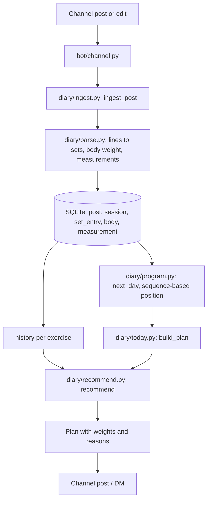

# Architecture

The project is two packages. `diary/` is pure logic over SQLite with no Telegram dependency (it also has a CLI);
`bot/` is a thin aiogram 3 layer that feeds posts into `diary/` and sends its output back.

## Data flow

1. A channel post or an edit arrives in `bot/channel.py` and goes to `ingest_post`.
2. `parse.py` classifies the post (`log`, `template`, `body`, `note`) and turns lines into sets.
   Exercise names are resolved through aliases and fuzzy matching; ambiguous pairs become rows in `suggestion`.
3. `ingest.py` stores the raw text and the parsed rows; the whole post is replaced on edit.
   A program post becomes `program` / `program_day` / `program_item`; a workout is matched to a program position (`session.ord`).
4. `program.next_day` picks the day after the last logged workout (unless the owner overrode it with `/cycle`, `/skip`, `/restart`).
5. `today.build_plan` gathers each exercise's history and calls `recommend`, then adds a warm-up and notes about breaks or pauses.
6. The plan is rendered as text/HTML and posted by the morning job or on `/plan`, `/today`.

## Data model

All tables are in `diary/schema.sql`.

| Table | Purpose |
| :--- | :--- |
| `post` | Every channel post: raw text, local day, kind, edit time, count of data-like lines that did not parse |
| `exercise` | Canonical exercise names with equipment type |
| `alias` | Normalized spelling to exercise |
| `suggestion` | Possible duplicate exercises awaiting merge or keep |
| `session` | One logged workout: day, program week/weekday/label, RIR, matched program position |
| `set_entry` | One set: reps or seconds, weight and weight kind, RIR, planned range, owner's hint, raw line |
| `program` | A program post: name, number of weeks, active flag |
| `program_day` | A day within a program with week, label, phase and RIR |
| `program_item` | An exercise slot in a program day: sets, rep range, timed or to-max |
| `body` | Body weight from a post |
| `measurement` | Named body measurements from a post |
| `sent_post` | Posts the bot itself published; never parsed as logs |
| `settings` | Key-value store: preferences, pause, scheduler markers, parser version, backup date |

## Autonomy mechanisms

**Parser re-parse.** `PARSER_VERSION` in `parse.py` is stored in `settings` after each parse.
On startup `reparse_if_needed` compares it with the stored value and, if it differs, re-runs the parser over every stored raw post.
A grammar fix therefore improves old data without a manual import.

**Migrations.** `schema.sql` only creates missing tables. Changes to existing tables are appended to `MIGRATIONS` in `db.py`;
each runs in a transaction and bumps `PRAGMA user_version`, so a database is upgraded exactly once per step.

**Scheduler.** `scheduler_loop` ticks every 30 seconds. Each job runs at most once per period (day or ISO week),
is marked as done *before* it runs so a failing job cannot loop, and may still run after downtime within its window.
Times are Moscow time.

| Job | Default time | Catch-up window | Condition |
| :--- | :--- | :--- | :--- |
| `morning` | 08:00 (`reminder_time`) | 2 h | training weekday, not paused, nothing logged today |
| `nudge` | 21:30 (`nudge_time`) | 2 h | same as morning |
| `summary` | 20:00 (`summary_time`) | 3 h | Sundays |
| `inactivity` | 12:00 | 10 h | 7+ days without a workout, once per last session, not paused |
| `backup` | 04:00 | 20 h | always |

**Heartbeat.** The scheduler writes a `heartbeat` file next to the database on every tick.
The Docker `HEALTHCHECK` fails if the file is older than 5 minutes. On startup the bot reads the previous heartbeat and,
if the gap exceeds 15 minutes, tells the owner it was down. Updates that arrived meanwhile are not dropped, so posts written during downtime are parsed.

**Backups.** The daily job copies the database with the SQLite backup API (consistent while the bot writes) into `backups/`
and keeps the 14 newest. On Mondays a copy is also sent to the owner (toggle `backup_send`). `/export` produces a CSV of all sets.

**Error alerts.** Failures in handlers and jobs are logged and reported to the owner, at most once per kind of error per 30 minutes.
One failing job does not stop the others.

**Zero-config pairing.** Only `BOT_TOKEN` is required. Until an owner is known, the bot accepts a forwarded channel post in a private chat.
The forward names the channel; the bot asks Telegram whether it and the sender are administrators there, and only then stores
the channel and the owner. `OWNER_ID` and `CHANNEL_ID` can still be set in the environment.

## Analytics

`diary/analytics.py` computes plain data from the same tables: session KPD (plan completion 40%, sets reaching the
bottom of the rep range 40%, progress against the same program day of the previous cycle 20%, deload sessions not
judged on progress), weekly consistency with streaks and the comeback after a break, sets per muscle group, strength
trends and written insights. `diary/charts.py` turns that data into PNGs with matplotlib's object API; `bot/ui.py`
prepares the data on the event loop and renders in `asyncio.to_thread`, so the shared SQLite connection is never used
from the worker thread.
