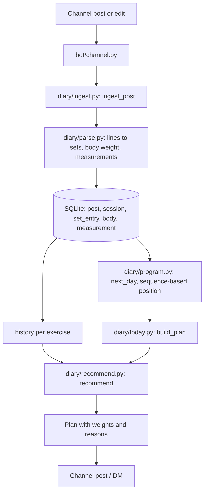

# Architecture

The project is two packages. `diary/` is pure logic over SQLite with no Telegram dependency (it also has a CLI);
`bot/` is a thin aiogram 3 layer that feeds posts into `diary/` and sends its output back.

## Data flow

1. A channel post or an edit arrives in `bot/channel.py` and goes to `ingest_post`.
2. `parse.py` classifies the post (`log`, `template`, `body`, `note`) and turns lines into sets.
   Exercise names are resolved through aliases and fuzzy matching; ambiguous pairs become rows in `suggestion`.
3. `ingest.py` stores the raw text and the parsed rows; the whole post is replaced on edit.
   A program post becomes `program` / `program_day` / `program_item`; a workout is matched to a program position (`session.ord`).
4. `program.next_day` picks the day after the last logged workout (unless the owner overrode it with `/cycle`, `/skip`, `/restart`).
5. `today.build_plan` gathers each exercise's history and calls `recommend`, then adds a warm-up and notes about breaks or pauses.
6. The plan is rendered as text/HTML and posted by the morning job or on `/plan`, `/today`.

## Data model

All tables are in `diary/schema.sql`.

| Table | Purpose |
| :--- | :--- |
| `post` | Every channel post: raw text, local day, kind, edit time, count of data-like lines that did not parse |
| `exercise` | Canonical exercise names with equipment type |
| `alias` | Normalized spelling to exercise |
| `suggestion` | Possible duplicate exercises awaiting merge or keep |
| `session` | One logged workout: day, program week/weekday/label, RIR, matched program position |
| `set_entry` | One set: reps or seconds, weight and weight kind, RIR, planned range, owner's hint, raw line |
| `program` | A program post: name, number of weeks, active flag |
| `program_day` | A day within a program with week, label, phase and RIR |
| `program_item` | An exercise slot in a program day: sets, rep range, timed or to-max |
| `body` | Body weight from a post |
| `measurement` | Named body measurements from a post |
| `sent_post` | Posts the bot itself published; never parsed as logs |
| `settings` | Key-value store: preferences, pause, scheduler markers, parser version, backup date |

## Autonomy mechanisms

**Parser re-parse.** `PARSER_VERSION` in `parse.py` is stored in `settings` after each parse.
On startup `reparse_if_needed` compares it with the stored value and, if it differs, re-runs the parser over every stored raw post.
A grammar fix therefore improves old data without a manual import.

**Migrations.** `schema.sql` only creates missing tables. Changes to existing tables are appended to `MIGRATIONS` in `db.py`;
each runs in a transaction and bumps `PRAGMA user_version`, so a database is upgraded exactly once per step.

**Scheduler.** `scheduler_loop` ticks every 30 seconds. Each job runs at most once per period (day or ISO week),
is marked as done *before* it runs so a failing job cannot loop, and may still run after downtime within its window.
A network failure (Telegram network/server errors, flood wait, timeouts, proxy errors) unmarks the job so a later tick retries it
within the window, with a growing pause and at most 6 attempts per period (counted in `settings`), then one alert.
Other errors are alerted once and not retried.
Times are in the owner's timezone (`DIARY_TZ`, default Europe/Moscow).

| Job | Default time | Catch-up window | Condition |
| :--- | :--- | :--- | :--- |
| `morning` | 08:00 (`reminder_time`) | 2 h | training weekday, not paused, nothing logged today |
| `nudge` | 21:30 (`nudge_time`) | 2 h | same as morning |
| `summary` | 20:00 (`summary_time`) | 3 h | Sundays |
| `inactivity` | 12:00 | 10 h | 7+ days without a workout, once per last session, not paused |
| `backup` | 04:00 | 20 h | always |

**Heartbeat and polling health.** The scheduler writes a `heartbeat` file next to the database (atomically) every tick,
but only while the last successful `getUpdates` is under 3 minutes old; a request middleware on the bot session records that time.
aiogram retries polling forever and swallows errors, so without this a revoked token, a 409 conflict or a dead proxy would leave a deaf bot with a fresh heartbeat.
The Docker `HEALTHCHECK` fails if the file is older than 5 minutes. A watchdog task logs an error, sends a best-effort alert and exits the process
after 15 minutes without a successful poll; `restart: unless-stopped` brings it back. On startup the bot reads the previous heartbeat
(missing or garbage means unknown downtime) and, if the gap exceeds 15 minutes, tells the owner it was down.
Telegram keeps unprocessed updates for about 24 hours: after a gap over 23 hours the bot says some posts may be missed and asks the owner
to forward them (a forwarded channel post is ingested as that post, idempotent by message id) or send a channel export.

**Pairing.** `OWNER_ID` / `CHANNEL_ID` win over the database. Without an owner the bot logs a random 6-digit code at startup; `/start <code>` in a private chat
claims ownership (five wrong tries lock claiming for ten minutes). The code is never sent to any chat. The channel is bound only by the owner:
a forwarded channel post (both the bot and the owner must be admins there) or an admin promotion done by the owner.
Posts from an unbound channel and promotions by strangers are ignored. `/rebind` switches the channel after a confirmation.

**Data directory.** The container runs as uid 1000. At startup the bot checks that the data directory is writable and otherwise exits with code 2 and the fix.

**Backups.** The daily job copies the database with the SQLite backup API (consistent while the bot writes) into `backups/`
and keeps the 14 newest; each copy is a single file (journal mode switched off WAL). On Mondays a copy is also sent to the owner (toggle `backup_send`). `/export` produces a CSV of all sets.

**Restore.** The owner sends a `.db` file: it must open as SQLite, pass `integrity_check`, contain `post`, `session` and `set_entry`,
and its `settings.owner_id` must be absent or the current owner. After confirmation the live database is first copied to `backups/pre-restore-*.db`,
then the file is copied into the open connection with the backup API (no stale `-wal` can undo it), posts are re-parsed if needed and program positions rebuilt.
Imports run in a worker thread with their own connection; zip uploads are read only for `result.json` / `messages*.html`, capped at 50 MB unpacked.
Bot API downloads are limited to 20 MB, so exports should be made without media.

**Error alerts.** Failures in handlers and jobs are logged and reported to the owner, at most once per kind of error per 30 minutes.
One failing job does not stop the others.

**Zero-config pairing.** Only `BOT_TOKEN` is required. Until an owner is known, the bot accepts a forwarded channel post in a private chat.
The forward names the channel; the bot asks Telegram whether it and the sender are administrators there, and only then stores
the channel and the owner. `OWNER_ID` and `CHANNEL_ID` can still be set in the environment.

## Analytics

`diary/analytics.py` computes plain data from the same tables: session KPD (plan completion 40%, sets reaching the
bottom of the rep range 40%, progress against the same program day of the previous cycle 20%, deload sessions not
judged on progress), weekly consistency with streaks and the comeback after a break, sets per muscle group, strength
trends and written insights. `diary/charts.py` turns that data into PNGs with matplotlib's object API; `bot/ui.py`
prepares the data on the event loop and renders in `asyncio.to_thread`, so the shared SQLite connection is never used
from the worker thread.

## Goals

`diary/goals.py` keeps one goal per exercise (a one-rep-max estimate; `80x5` is converted with Epley and shown back as
written) and one body-weight goal. The pace is a Theil–Sen trend over the sessions since the last break inside 120 days:
the median of the slopes between pairs of sessions at least a week apart, with the interquartile slopes giving the date
range. Deload sessions are left out. With fewer than four points over three weeks there is no forecast, only the current
level; a pace under 0,1 kg a week is reported as flat rather than as a date years away, and forecasts beyond half a
year carry a caution, because strength gains slow down. `check_achieved` runs after every live log or body post.
